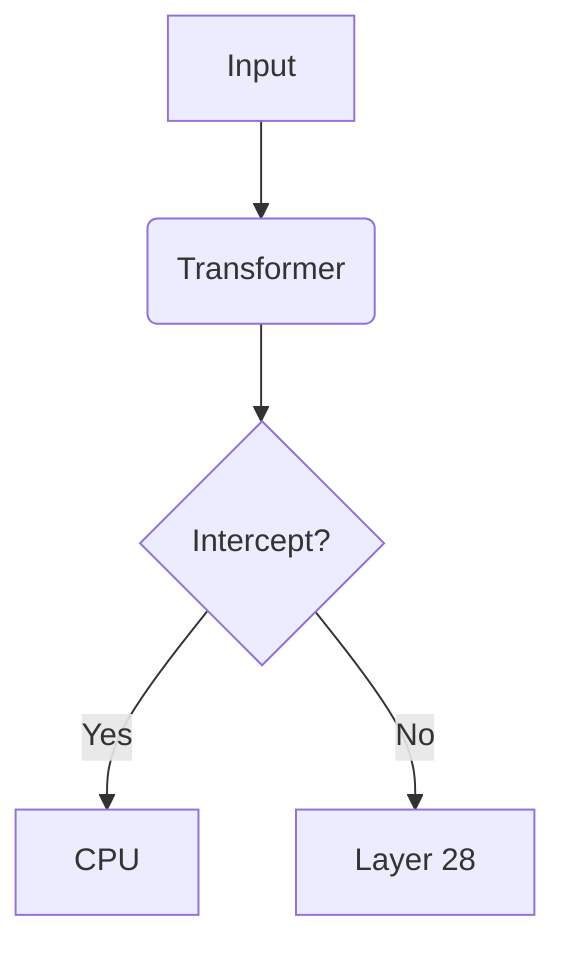

# Scriptorium: Markdown-to-DOCX Compiler for Academic Preprints

**Scriptorium** — это специализированный движок для компиляции Markdown-файлов в единый, безупречно отформатированный документ Microsoft Word (.docx). Проект создан для исследователей, которым нужна академическая строгость без боли ручной верстки.

Инструмент объединяет простоту Markdown с мощью профессиональных издательских систем, поддерживая двуязычные тексты, сложную математику и подсветку синтаксиса.

## ✨ Ключевые возможности

*   **📚 Умная сборка:** Автоматически сканирует папку `text/`, сортирует файлы по нумерации (`01_`, `02_`...) и собирает их в единую книгу.
*   **📑 Нативное оглавление:** Генерирует реальное поле `TOC` в Word, которое можно обновить по нажатию F9.
*   **🧮 Формулы (OMML):** Полная поддержка LaTeX. Формулы конвертируются в нативные математические объекты Word, а не в картинки.
*   **🎨 Подсветка кода (Pygments):** Нативная подсветка синтаксиса Python, C++, JSON и других языков. Код не ломается при конвертации в PDF.
*   **📊 Умные таблицы:** Автоматическая ширина колонок, заливка заголовков и выравнивание чисел по правому краю.
*   **📐 Mermaid.js:** Поддержка блок-схем. Просто напишите ` ```mermaid `, и скрипт сам сгенерирует PNG-картинку и вставит её в документ.
*   **💡 Callout-блоки:** Красивые цветные врезки (`NOTE`, `WARNING`, `TIP`) с иконками и цветными границами.
*   **🔗 HTML-теги:** Поддержка инлайн-тегов `<sub>`, `<sup>`, `<b>`, `<i>`, `<br>` и `<code>`.
*   **📝 Метаданные:** Автоматически заполняет свойства DOCX-файла (автор, ключевые слова, название) для корректной работы в Zotero и Mendeley.
*   **🌍 Двуязычность:** Автоматически определяет язык абзаца (RU или EN) для расстановки правильных переносов.

## 🚀 Быстрый старт

### 1. Установка зависимостей

```bash
pip install python-docx pygments latex2mathml mathml2omml lxml
```

*Для работы Mermaid-диаграмм необходимо установить [mermaid-cli](https://github.com/mermaid-js/mermaid-cli) глобально:*
```bash
npm install -g @mermaid-js/mermaid-cli
```

### 2. Структура проекта

Организуйте файлы в вашей рабочей директории следующим образом:

```text
my-research-paper/
├── build_docx.py            # Скрипт-компилятор
├── comprehensive_experiment.py  # (Опционально) Код для Приложения А
└── text/
    ├── title-page.md        # Титульный лист (шаблон)
    ├── 01_introduction.md   # Глава 1
    ├── 02_architecture.md   # Глава 2
    └── 03_conclusion.md     # Глава 3
```

### 3. Запуск

```bash
python build_docx.py
```
На выходе вы получите файл `Universal_Academic_Report.docx`.

## 📖 Синтаксис Markdown (Расширения)

Помимо стандартного Markdown, Scriptorium поддерживает:

### Callout-блоки (Врезки)
```markdown
> [!NOTE]
> Это важное примечание.

> [!WARNING]
> Внимание! Это предупреждение.

> [!TIP]
> Полезный совет.
```

### Формулы
Выключные формулы оборачиваются в `$$` или `\[ ... \]`.
```latex
\[
 \Delta_{\text{friction}} = \Delta_{\text{geom}} \times \Delta_{\text{info}} 
\]
```

### Подписи к рисункам и таблицам
```markdown

```
*Скрипт автоматически добавит "Рис. 1. Архитектура системы" под картинкой.*

### Диаграммы Mermaid
````markdown

````

### Сноски (Концевые)
```markdown
Текст со сноской[^1].

[^1]: Текст сноски.
```

## ⚖️ Лицензия

Этот проект распространяется под лицензией **MIT**. Вы можете свободно использовать, модифицировать и распространять его в академических и коммерческих целях.